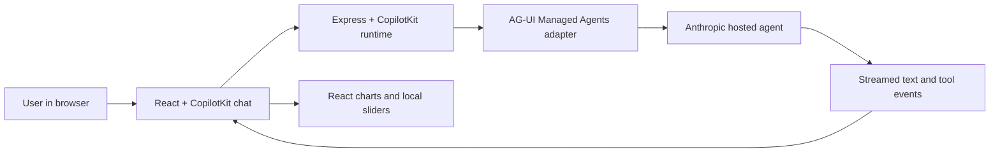

# DAMG-7245-copilot-kit-ag-ui_Team_2

A personal-finance assistant that answers questions in chat and displays interactive charts. Our team extends the starter with a Stocks vs. HYSA Scenario Explorer, a Savings Goal Planner, and explicit current-scenario explanations. See [the demo walkthrough](docs/stocks-vs-hysa-demo.md) for the changes, assumptions, tests, and presentation script.

## What we are building

A user can ask about debt, savings, investments, or a monthly budget. Claude chooses a visual tool and supplies its initial values. React renders the chart in the conversation. Moving a slider recalculates locally. On growth, Stocks vs. HYSA, and savings-goal cards, clicking “Explain my current scenario” explicitly sends the current state as a new agent message.

The four original visuals are included: debt payoff, investment growth, budget breakdown, and scenario comparison. This is an educational planning demo, with no bank connection, transaction database, or trading functionality.

- **CopilotKit** provides the chat interface and runtime.
- **AG-UI** provides the event format connecting the agent and interface.
- **Claude Managed Agents** hosts the agent execution and tools.
- **Our application** connects these pieces and defines the finance prompt, visual tools, and chart components.

## Is this starter enough?

Yes, for a small local demonstration of agent chat and interactive UI, provided the team has Managed Agents access. No additional database, vector store, Python backend, or agent framework is required for that scope.

Submission scope: the working finance starter plus two new tools, `show_savings_vs_investing` and `show_savings_goal`, with deterministic calculations, 6/12-month controls, hypothetical downside/flat/upside stock scenarios, and a HYSA projection. Run `npm test` for the new calculation and tool-contract tests. See [demo and expected results](docs/stocks-vs-hysa-demo.md).

Before sharing a hosted deployment, add authentication and rate limits. The current API is unauthenticated and messages consume the account's credits. CORS restrictions do not authenticate users or stop direct API callers. Add persistent session mapping if conversations must survive server restarts. A database is useful at that point, rather than a prerequisite for the demo.

## Run locally

1. Install Node 22 or newer and dependencies with `npm ci`.
2. Install Anthropic's `ant` CLI 2.0 or newer using the [official CLI instructions](https://platform.claude.com/docs/en/cli-sdks-libraries/cli/quickstart).
3. Authenticate with `ant auth login`, or export `ANTHROPIC_API_KEY` securely in your shell. Do not commit credentials.
4. Confirm the account has Managed Agents beta access and access to the configured model. The upstream starter specifies `claude-fable-5` and requires an organization with 30-day retention; this account was provisioned successfully and a live growth-chart conversation was verified during setup.
5. Run `ant apply agents environments` from this directory. This creates cloud resources and writes `claude-lock.json`. The CLI does not load `.env` automatically.
6. Run `npm run dev` and open http://localhost:5173.

Try: “Show a growth projection for investing $500 per month at an assumed 7% annual return for 20 years.” Then try a debt-payoff prompt and move a chart slider.

Optional server configuration is documented in `.env.example`. `npm run typecheck` checks both workspaces. `npm run build` builds the frontend; `npm start` serves it with the API on port 8787. There is no `npm run setup` command in this imported version.

## Code map

| Path | Purpose |
| --- | --- |
| `agents/financial-assistant.md` | Agent model, tools, and instructions |
| `environments/financial-assistant.yaml` | Hosted execution environment and networking restrictions |
| `server/src/index.ts` | Express API, runtime, adapter, and in-memory session mapping |
| `server/src/resources.ts` | Load provisioned resource IDs; lockfile takes precedence over environment variables |
| `server/src/vizTools.ts` | Four visual tool contracts |
| `web/src/App.tsx` | Chat page |
| `web/src/viz/renderers.tsx` | Match agent tool calls to chart components |
| `web/src/viz/finance.ts` | Debt and growth calculations |
| `web/src/viz/` | Charts, sliders, and tool activity display |

## Review notes

The starter is deliberately a demo. The starter has no CI workflow, authentication, rate limiting, or persistent application database. This extension adds focused automated tests for both new tools and their calculations. Session mappings are in memory; restarting the server loses the mapping to earlier hosted sessions.

Input validation could be tightened before extending the visual tools: frontend schemas do not enforce every server-side bound, and budget amounts allow negative numbers although the chart filters them out. These are follow-up hardening items in the original tools; the new tools use bounded inputs. The growth chart now labels its actual calculation horizon, including the original 50-year cap.

## Starter provenance

Imported on November 12, 2026 from [anthropics/claude-quickstarts](https://github.com/anthropics/claude-quickstarts/tree/4a4224bdf0e9cfb3332167b69c90457403813625/managed-agents/copilot-kit-ag-ui), commit `4a4224bdf0e9cfb3332167b69c90457403813625`, subdirectory `managed-agents/copilot-kit-ag-ui`.

All starter files were imported. The upstream README is preserved in [STARTER_README.md](STARTER_README.md), the upstream license in [LICENSE](LICENSE), and the existing team `.gitignore` was extended for Node dependencies, builds, local credentials, and resource IDs. The team's existing Git remote and history were preserved. The baseline was subsequently committed and pushed to main; feature work is on `feature/course-project`. The agent and environment were provisioned during local setup; local resource IDs remain ignored.

## Import validation

On November 12, 2026: `npm ci`, `npm run typecheck`, and `npm run build` passed. A temporary server with dummy resource IDs returned HTTP 200 for the built frontend and `/api/copilotkit/info`, which listed `financial-assistant`. No live agent turn or browser interaction was tested. Vite reported large bundle chunks (the main JavaScript bundle is approximately 2.1 MB before gzip); dependency installation reported upstream deprecations. All imported application files match the recorded upstream commit.

## Team feature validation

The team extensions pass eighteen automated tests, both workspace typechecks, and the production build. A live Claude call rendered the comparison. Browser checks verified six- and twelve-month results and zero-contribution/zero-APY behavior. See [the reproducible demo](docs/stocks-vs-hysa-demo.md).

The empty chat also offers four clickable starter questions, configured in `web/src/StarterQuestions.tsx`. They disappear after the first message.

## EC2 demo

See [the EC2 deployment walkthrough](docs/ec2-demo.md) for the private presentation-laptop deployment, secure key setup, direct IPv4 HTTPS, network changes, and shutdown instructions.

## Interactive demo guide

Open [docs/demo-guide.html](docs/demo-guide.html) in a browser for a self-contained walkthrough: clickable architecture, three request traces, an offline chart-versus-agent-state simulator, all six tools and their source files, and a seven-step presentation script. It does not call Claude or spend API credits.
